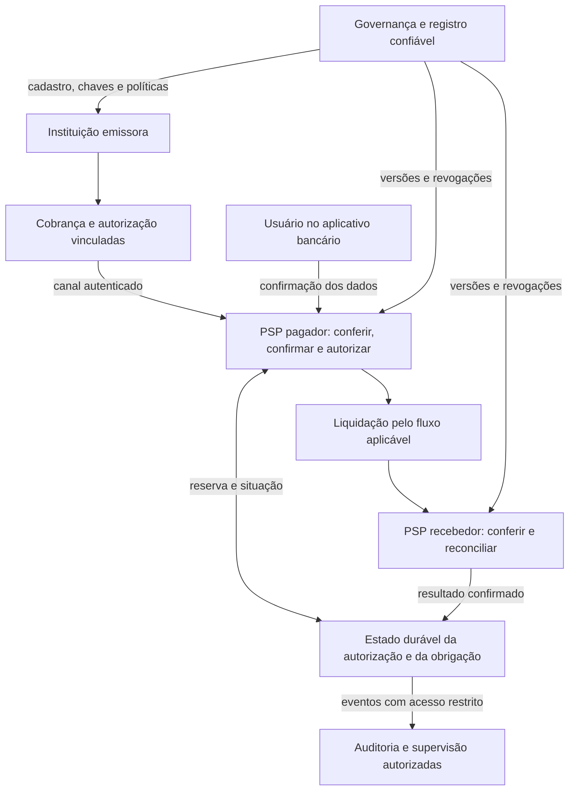
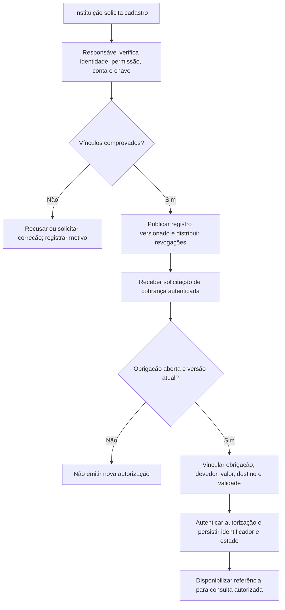
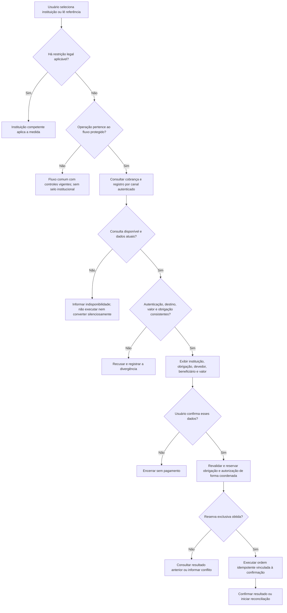
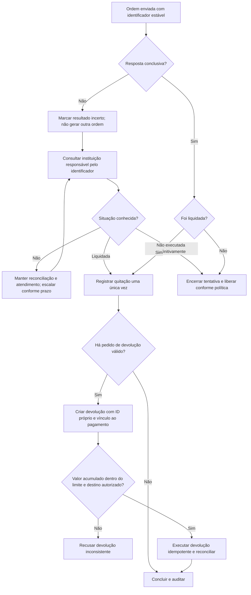
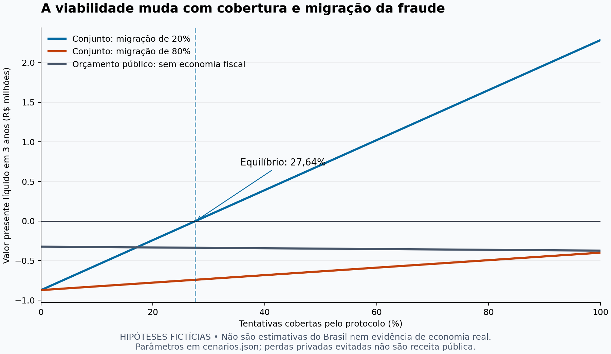

# Cobranças verificáveis e fiscalização financeira

**Proposta de infraestrutura para reduzir fraudes de personificação e avaliar o custo da fiscalização no Brasil.**

Versão 7.1 · 26 de setembro de 2026 · Proposta técnica independente para discussão pública

**Estágio:** arquitetura com prova de conceito local e calculadora reproduzível de viabilidade. Há 16 casos de teste executados, mas não há integração bancária, piloto de campo ou economia comprovada. Os componentes descritos são propostas; sua menção não indica adoção ou vínculo com órgãos públicos, bancos ou prestadores de serviços.

**Para verificar:** os fluxogramas operacionais estão na seção 7; as equações e os cenários econômicos, na seção 11; o código, os resultados reproduzíveis e o protocolo de validação, na seção 13. As fórmulas estabelecem condições de aceitação e rejeição, não substituem dados de campo.

## 1. Por que esta proposta existe

Esta proposta nasceu da leitura de notícias sobre restrições financeiras e encerramento de operações de apostas no Brasil. A mudança de um regime de autorização para proibição suscita uma pergunta sobre o uso do dinheiro público: **como executar a fiscalização com efetividade, custo sustentável e o menor impacto possível sobre atividades legítimas?**

Fiscalizar envolve identificar responsáveis, reunir evidências, comunicar determinações, acompanhar seu cumprimento e responder à adaptação dos infratores. Bloquear um endereço não encerra necessariamente a atividade que o utiliza. Novos domínios, contas e intermediários podem exigir novas intervenções.

A hipótese deste documento é que parte do trabalho repetitivo pode ser reduzida por uma infraestrutura compartilhada de identificação de recebedores e autenticação de cobranças, integrada aos pontos em que os pagamentos são autorizados. Sua utilidade pode alcançar cobranças de órgãos públicos, concessionárias e empresas, além de controles financeiros associados à fiscalização setorial.

O objetivo é submeter essa hipótese a comparação técnica e econômica. A economia potencial ainda precisa ser quantificada. Para isso, a proposta defende que custos, alternativas, resultados e limites da execução sejam explicitados, permitindo avaliar as escolhas de política pública com base em evidências.

## 2. A ideia central

**Vincular a cobrança à instituição, à obrigação e ao destinatário corretos, conferindo esses vínculos em um canal confiável antes da execução do pagamento.**

Um site pode copiar a aparência de um órgão público. Isso não deveria ser suficiente para que um pagamento a qualquer conta fosse apresentado pelo banco como quitação de uma obrigação daquele órgão.

Exemplo de experiência proposta:

1. O cidadão acessa, no aplicativo bancário, uma instituição cadastrada em um diretório confiável.
2. O banco consulta a cobrança por uma interface autenticada e verifica sua origem, validade e destino.
3. A tela de confirmação identifica a instituição, o beneficiário efetivo, a obrigação, o devedor e o valor, com proteção dos dados pessoais.
4. A ordem executada deve corresponder aos dados confirmados pelo cidadão.

Outra jornada pode começar pela leitura de um QR Code, desde que o banco consiga verificar os mesmos vínculos. Uma informação recebida de uma página ou QR Code permanece não confiável até essa verificação.

Esse mecanismo busca reduzir substituição de destinatários e de cobranças nos fluxos integrados. A autenticação de uma cobrança não comprova, isoladamente, a licitude de todo negócio, a entrega de um produto ou a ausência de fraude pelo próprio emissor.

## 3. Escopo e contexto regulatório

### 3.1. Aplicações propostas

| Aplicação | Objetivo | Condição |
|---|---|---|
| Órgãos públicos e concessionárias | Conferir que a cobrança corresponde à instituição, ao serviço e à obrigação pretendidos. | Integração com o emissor e os prestadores de pagamento. |
| Comércio eletrônico | Conferir identidade do vendedor, pedido, beneficiário e valor. | Cadastro e regras para vendedores, intermediários e recebedores. Não garante entrega. |
| Fiscalização financeira | Aplicar restrições fundamentadas a entidades e contas identificadas; melhorar rastreabilidade e evidências. | Competência legal, processo aplicável e integração dos participantes. |
| Encerramento e restituição | Conciliar obrigações e executar pagamentos de devolução aos destinatários corretos. | Regras específicas, dados de origem e instituições responsáveis. |
| Eventual regime futuro de apostas autorizadas | Avaliar controles de entrada, saída e rastreabilidade. | Admissibilidade jurídica e especificação próprias. Não é o piloto inicial. |

### 3.2. Referência normativa datada

Na referência de **26/09/2026**, a [MP nº 1.394, de 25/09/2026](https://www.planalto.gov.br/ccivil_03/_ato2023-2026/2026/mpv/mpv1394.htm) estabelece proibição de apostas de quota fixa e transição para encerramento. O art. 7º, §1º, veda novos recursos nas contas transacionais, ressalvadas as exceções expressas. Os arts. 14 e 15 tratam de restrições financeiras e comunicação para rejeições e devoluções. Essas medidas se dirigem às apostas; **não extinguem o Pix**.

Por isso, este documento não propõe habilitar novos depósitos em apostas sob esse cenário. A aplicação setorial depende do regime vigente, de sua regulamentação e de eventuais alterações ou decisões posteriores. Uma mudança normativa exige revisar esta seção e as políticas de execução.

O modelo existente também inclui controles financeiros. O texto consolidado da [Lei nº 14.790/2023, art. 24-B](https://www.planalto.gov.br/ccivil_03/_ato2023-2026/2023/lei/l14790.htm) contém previsões sobre mecanismos específicos no Pix, incluindo a possibilidade de modalidade vinculada a cadastro positivo. Previsão legal, regulamentação e disponibilidade de uma interface técnica são etapas distintas. Este projeto não presume que um token governamental por operação já exista.

## 4. O que existe e o que seria acrescentado

| Elemento | Situação considerada nesta proposta |
|---|---|
| Pix e seus padrões de iniciação | Infraestrutura existente. A integração deve obedecer às especificações efetivamente aplicáveis. |
| QR Code dinâmico com conteúdo assinado | Recurso já descrito no padrão Pix. Uma nova proposta precisa acrescentar vínculos e regras de negócio, além da assinatura. |
| SIGAP | Possui documentação pública para integração e envio de dados. Não se presume serviço síncrono de autorização de cada pagamento. |
| Registro de instituições, permissões, contas e chaves | Componente proposto, com governança a definir e possibilidade de aproveitar cadastros existentes. |
| Autorização vinculada à cobrança e à obrigação | Contrato proposto entre participantes; não é um campo oficial novo do Pix criado por este README. |
| Confirmação institucional no aplicativo bancário | Funcionalidade proposta, dependente de implementação pelo prestador participante. |
| Validação nacional obrigatória | Dependeria de decisões dos responsáveis pelo arranjo, padronização, competências e homologação. |

O [Manual de Padrões para Iniciação do Pix, versão 2.10.0](https://www.bcb.gov.br/content/estabilidadefinanceira/pix/Regulamento_Pix/II_ManualdePadroesparaIniciacaodoPix.pdf) descreve o conteúdo assinado de cobranças dinâmicas. A assinatura protege a mensagem conforme o protocolo; não comprova que a marca anunciada numa página externa corresponde ao negócio real. A [documentação do SIGAP](https://documentacao-sigap-rec.ni.estaleiro.serpro.gov.br/) descreve suas interfaces disponíveis, que não devem ser confundidas com os componentes novos aqui sugeridos.

## 5. Modelo de ameaças e limites

A proteção depende da integridade dos participantes, do cadastro, das chaves e da interface em que o usuário confirma o pagamento. Falhas nessas bases precisam ser tratadas, não ocultadas pela existência de uma assinatura digital.

| Ameaça | Controle proposto | Limite ou risco residual |
|---|---|---|
| Site que imita uma instituição | Conferência de instituição e cobrança no banco. | A página falsa ainda pode existir e tentar conduzir o usuário a outro fluxo. |
| QR Code com destinatário substituído | Comparação do destino efetivo com a autorização. | Exige participação do sistema que autoriza a ordem. |
| Cobrança autêntica de outra pessoa | Vínculo e apresentação da obrigação e do devedor. | Pagamentos legítimos por terceiros exigem regra explícita. |
| Alteração após confirmação | Vinculação entre os dados exibidos, a confirmação e a ordem. | Interface ou dispositivo comprometido permanece ameaça relevante. |
| Repetição ou concorrência | Estado durável, unicidade e execução idempotente. | Precisa ser demonstrada também entre os participantes integrados. |
| Empresa que oculta sua atividade | Conhecimento do recebedor, análise de risco e investigação. | Cadastro ou certificado não revela automaticamente a finalidade real. |
| Pulverização em sites e contas | Correlação de evidências e contenção proporcional. | Não há garantia de gateway único ou convergência facilmente identificável. |
| Chave ou cadastro comprometido | Segregação de funções, proteção de chaves, revogação e recuperação. | Uma assinatura válida pode ter sido produzida por um agente comprometido. |
| Emissor legítimo conivente | Limites, supervisão, auditoria e responsabilização aplicável. | Autenticar o emissor não comprova a legitimidade da dívida que ele declara. |
| Uso de outras rotas de pagamento | Fiscalização complementar e avaliação de cobertura. | O protocolo não controla sistemas que não o implementam. |

### Por que um selo no site não basta

Uma página fraudulenta pode desenhar um selo verde ou direcionar o usuário à consulta de uma empresa verdadeira. Não possuir a chave privada não impede a cópia visual. A verificação relevante deve ocorrer no aplicativo bancário ou em outro canal confiável e mostrar precisamente qual entidade, domínio ou cobrança foi verificado.

IP, endereço informado em um parâmetro e página de procedência não bastam para autenticar a navegação anterior. Um diretório público pode informar o domínio cadastrado; isso não atesta automaticamente a página da qual o visitante saiu.

### Por que o banco não pode adivinhar a intenção

Um mesmo Pix de R$ 100 pode ser apresentado numa venda legítima ou numa página que promete falsamente quitar uma taxa. Se o banco recebe os mesmos dados, eles não permitem distinguir as duas situações com certeza.

Consequentemente, ausência da nova autorização não transforma todo Pix comum em fraude. A exigência deve ter um escopo definido, e operações fora dele permanecem sujeitas às regras e aos controles de risco aplicáveis.

## 6. Arquitetura proposta

A proposta combina **governança de um registro confiável com execução pelos prestadores de pagamento participantes**. PSP significa prestador de serviços de pagamento, como a instituição que mantém a conta do pagador ou do recebedor.



O diagrama mostra responsabilidades lógicas, não uma API disponível. O responsável pelo estado de cada obrigação e de suas autorizações associadas, assim como o protocolo de coordenação, precisa ser definido antes da implementação.

O registro pode distribuir versões assinadas e atualizações aos PSPs, evitando uma consulta governamental síncrona para cada pagamento. Isso reduz uma dependência, mas exige validade dos dados, proteção contra versões antigas e política de revogação. O controle de uso único continua dependendo de estado consistente.

Uma intervenção exclusiva no SPI não cobriria todo o Pix: o BC distingue operações liquidadas no SPI daquelas liquidadas nos livros do participante. A cobertura precisa incluir os caminhos internos dos PSPs e declarar quais instrumentos ficam fora do projeto. [Estatísticas do SPI](https://www.bcb.gov.br/estabilidadefinanceira/estatisticas_spi).

Integrações com SIGAP, Gov.br ou infraestrutura do BC só podem ser previstas mediante interfaces e competências confirmadas. A arquitetura básica não exige que esses serviços operem como validadores de cada cobrança.

## 7. Fluxo de pagamento protegido

### 7.1. Cadastro e emissão



### 7.2. Decisão e execução do pagamento



O pertencimento ao fluxo deve vir da jornada selecionada e das regras dos participantes; um campo arbitrário no QR Code não pode desativar um controle obrigatório. A revalidação após a confirmação reduz a janela entre consulta e execução. Sua coordenação com revogação e liquidação entre PSPs ainda precisa de especificação.

### 7.3. Resultado incerto e devolução



Ausência de registro numa consulta temporariamente incompleta não equivale a confirmação de não execução. O fluxo exige uma resposta definitiva da autoridade responsável. O protótipo local abaixo simula perda de resposta após confirmação; ele não implementa esse protocolo entre bancos.

### 7.4. Responsabilidades de cada passo

1. **Cadastrar a instituição e seus vínculos.** Verificar identidade, representantes, permissões, contas e chaves. Quando houver arrecadador ou intermediário, registrar a relação com o beneficiário e exibi-la de forma compreensível. Alterações de destino exigem controles reforçados.
2. **Criar a cobrança e sua autorização.** Vincular instituição, obrigação, destinatário, valor, validade e política aplicável. A emissão deve verificar se a obrigação já foi quitada, substituída ou cancelada.
3. **Obter os dados por canal autenticado.** O banco resolve a referência da cobrança no serviço acordado. A referência pode ser opaca para minimizar exposição; o acesso aos dados continua exigindo autorização.
4. **Conferir e apresentar.** Comparar assinatura, cadastro, conta efetiva, situação, obrigação e valor. Mostrar os dados relevantes ao usuário antes da confirmação. Pagador e devedor são conceitos diferentes.
5. **Reservar e executar.** Associar a confirmação a uma ordem imutável e idempotente. Uma autorização de cobrança não concede, por si só, permissão para debitar a conta do usuário.
6. **Confirmar e reconciliar.** Registrar o resultado obtido da instituição responsável. Timeout não prova que o pagamento falhou; comprovante enviado pelo navegador não prova que foi liquidado.
7. **Tratar exceções e devoluções.** Recuperar resultados incertos, processar devoluções vinculadas e manter trilha de auditoria, sem reabrir indevidamente autorizações consumidas.

### Decisão no aplicativo bancário

| Situação | Comportamento esperado |
|---|---|
| Cobrança protegida, válida e consistente | Apresentar dados verificados e solicitar a confirmação prevista no fluxo. |
| Cobrança protegida com assinatura, destino ou estado inválidos | Recusar a execução nesse fluxo e informar motivo compreensível. |
| Não foi possível verificar uma cobrança protegida | Informar a indisponibilidade; aplicar contingência previamente definida, sem convertê-la silenciosamente em Pix comum. |
| Pix comum fora do escopo protegido | Aplicar controles normais e restrições vigentes; não apresentar identidade institucional não comprovada. |
| Conta ou entidade sujeita a restrição aplicável | Executar a medida pela instituição competente, independentemente de existir token. |

Recusar antes de executar e devolver depois de liquidar são resultados distintos. O piloto deve comprovar em qual ponto consegue agir e nunca apresentar uma devolução posterior como prevenção anterior ao débito.

## 8. Contrato técnico mínimo

### 8.1. Conteúdo autenticado

Os elementos abaixo são conceituais. Não representam novos campos oficiais do Pix ou endpoints do governo.

| Grupo | Elementos necessários |
|---|---|
| Identificação | Versão do protocolo, tipo de autorização, emissor, verificadores permitidos e identificador único. |
| Chaves | Identificação da chave e perfil criptográfico aceito pelo verificador. |
| Instituição e destino | Entidade, permissão aplicável, beneficiário, intermediário quando houver e conta efetiva ou referência imutável e versionada ao destino. |
| Cobrança e obrigação | Identificadores e versões; finalidade; referência ao devedor quando necessária; política para pagamento por terceiros. |
| Pagamento | Valor, moeda e vinculação do pagador quando exigida pelo caso de uso. Dinheiro com precisão decimal definida ou centavos inteiros. |
| Tempo e política | Emissão, início da validade, expiração e versão das regras aplicáveis. |

A assinatura da instituição é verificada com a chave pública correspondente dessa instituição, autenticada pelo registro. Uma declaração assinada pela autoridade do registro é verificada com a pública da autoridade. Chaves privadas permanecem protegidas sob responsabilidade de seus titulares.

Se JWS/JWT for adotado, definir algoritmos permitidos, emissor, audiência, tipos e validações obrigatórias. Não aceitar chaves arbitrárias indicadas pelo remetente. JWS fornece integridade e autenticação da mensagem; seu conteúdo não se torna confidencial por estar assinado. [RFC 7515](https://www.rfc-editor.org/rfc/rfc7515.html) e [RFC 8725](https://www.rfc-editor.org/rfc/rfc8725.html).

TLS protege as conexões. mTLS pode autenticar serviços entre si quando o perfil de integração o exigir, mas não substitui autorização, autenticação do usuário ou integridade dos sistemas. O perfil dos certificados precisa ser especificado, em vez de pressupor que qualquer certificado empresarial serve para todas essas funções. [RFC 8446](https://www.rfc-editor.org/rfc/rfc8446.html).

### 8.2. Estado, repetição e concorrência

O token assinado permanece imutável. Seu estado de utilização é mantido no servidor responsável e não pode ser determinado por uma declaração do cliente.

O protocolo deve tratar criação, reserva, processamento, liquidação, cancelamento, expiração e reconciliação. Também deve:

- Impedir consumo duplicado da autorização e quitação indevida da mesma obrigação por autorizações diferentes.
- Definir reemissão, substituição e pagamentos parciais; o piloto inicial pode limitar-se a uma quitação integral por obrigação.
- Preservar resultado incerto após falha de comunicação, sem liberar nova execução enquanto a situação anterior não for resolvida.
- Distinguir cancelamento anterior à execução de devolução posterior. Devoluções têm identificador próprio, vínculo ao pagamento, idempotência e limite de valor acumulado.
- Garantir que uma mudança de conta, valor ou obrigação após a confirmação exija nova autorização e confirmação apropriada.

Um banco de dados transacional com restrições de unicidade pode sustentar o protótipo. Filas e eventos auxiliam integração e reconciliação, mas não asseguram sozinhos atomicidade entre instituições. Antes de alegar uso único entre PSPs, é necessário demonstrar como todos consultam e respeitam a autoridade responsável pela obrigação e por suas autorizações associadas. Reservar cada autorização isoladamente não impede duas quitações simultâneas da mesma dívida com autorizações diferentes.

### 8.3. Transporte e compatibilidade

O piloto deve usar cobranças Pix suportadas pelo parceiro e manter a vinculação adicional em interface acordada. Inserir texto num campo livre, ou usar um identificador de correlação, não obriga outros bancos a aplicar uma regra nova.

Uma expansão exige especificar transporte, autenticação, semântica, códigos de erro, idempotência, tempos, versionamento, migração e homologação. Boletos e outros instrumentos precisam de integração própria; a proteção de um fluxo Pix não se transfere automaticamente para eles.

## 9. Governança, privacidade e continuidade

### Registro e participantes

Definir quem admite instituições, verifica vínculos, publica políticas, suspende permissões e corrige erros. Os critérios devem ser objetivos, auditáveis e acessíveis a participantes de diferentes portes. Evitar que a infraestrutura de confiança se torne uma barreira comercial injustificada.

O comprometimento do registro pode afetar muitos participantes. Por isso, o desenho deve prever segregação para alterações críticas, proteção de chaves, trilhas auditáveis, revogação emergencial e recuperação de confiança. Cópias distribuídas precisam rejeitar versões antigas indevidas, inclusive após reinicializações.

### Dados pessoais

Separar o diretório público de instituições das informações restritas de clientes, dívidas e pagamentos. Minimizar dados no QR Code, nos tokens e nos logs; referências opacas não dispensam controle de acesso, proteção contra enumeração e limites de consulta.

Documentar finalidade, base legal, responsabilidades, compartilhamento, retenção e acesso. Avaliar os riscos e as salvaguardas por meio de relatório de impacto quando aplicável; sua elaboração antecipada é recomendada para o piloto. [LGPD](https://www.planalto.gov.br/ccivil_03/_ato2015-2018/2018/lei/l13709compilado.htm).

### Disponibilidade

Antes do piloto, estabelecer metas de disponibilidade, latência, capacidade, recuperação e propagação de revogações. A contingência deve distinguir indisponibilidade temporária de autorização inválida e ter duração e consequências conhecidas.

Manter atendimento e caminho de recuperação para pagamentos pendentes. Não liberar uma operação fora da política nem conservar recursos em estado indefinido apenas porque um componente não respondeu.

## 10. Fiscalização de operações fora do fluxo protegido

A infraestrutura proposta melhora controles onde há participantes integrados e identidades verificáveis. Atividades clandestinas podem recorrer a contas interpostas, comerciantes de fachada, múltiplos provedores e outras rotas. Isso preserva a necessidade de fiscalização complementar.

Controles úteis incluem conhecimento do cliente e da empresa recebedora, acompanhamento de mudanças cadastrais, inteligência financeira, correlação de evidências e análise de padrões. Horário, volume ou convergência de pagamentos são sinais de risco, não provas isoladas.

Coleta ativa de evidências deve observar competência, procedimentos e preservação da informação. Identificar uma conta num QR Code, atribuir uma atividade ilícita e executar uma medida financeira são etapas diferentes. O bloqueio de uma credencial compartilhada também pode atingir terceiros legítimos.

Responsabilidades devem ser atribuídas com precisão. A [Resolução CMN nº 5.320/2026](https://www.bcb.gov.br/estabilidadefinanceira/exibenormativo?numero=5320&tipo=Resolu%C3%A7%C3%A3o+CMN) trata de bloqueio de contas e impedimento de transações. A responsabilidade solidária tributária prevista no [art. 6º da LC nº 224/2025](https://www2.camara.leg.br/legin/fed/leicom/2025/leicomplementar-224-26-dezembro-2025-798608-normaatualizada-pl.html) tem condições próprias, incluindo comunicação formal e específica na hipótese aplicável às instituições. Isso não equivale a uma responsabilidade automática e indistinta por qualquer fraude.

As medidas de fiscalização precisam acompanhar a norma aplicável, a competência do responsável e os mecanismos de revisão. O [catálogo de legislação da SPA](https://www.gov.br/fazenda/pt-br/composicao/orgaos/secretaria-de-premios-e-apostas/apostas-de-quota-fixa/legislacao/apostas) é uma referência para conferir atualizações setoriais.

## 11. Como avaliar economia de dinheiro público

### 11.1. Variáveis que precisam ser medidas

O modelo compara a proposta com os controles já existentes, no mesmo horizonte e população. Todos os custos e benefícios são **incrementais**. A perspectiva conjunta reúne pagadores e operadores sem contar a mesma perda, restituição ou transferência duas vezes; ela não representa automaticamente ganho para o Tesouro nem uma avaliação completa de bem-estar social.

| Símbolo | Definição e unidade | Como obter |
|---|---|---|
| $N$ | Tentativas de pagamento no período, inclusive recusadas. | Eventos deduplicados por intenção de pagamento; separar repetição técnica. |
| $p$ | Fração de tentativas fraudulentas, adjudicadas independentemente. | Amostra investigada, sem tratar recusa do próprio sistema como prova de fraude. |
| $a$ | Fração coberta pelo protocolo, entre 0 e 1. | Jornadas elegíveis e efetivamente integradas, com denominador explícito. |
| $L$ | Perda monetária média por tentativa fraudulenta sob os controles atuais. | Perdas líquidas de recuperação, incluindo tentativas sem perda; não usar automaticamente o valor solicitado. |
| $s$ | Fração incremental da perda de referência evitada no fluxo coberto. | Comparação com o que ocorreria sem o novo controle. Não é, necessariamente, a sensibilidade de um classificador. |
| $m$ | Razão entre perdas deslocadas para outras rotas e perdas inicialmente evitadas. | Acompanhar população e horizonte além do fluxo integrado. Pode superar 1 se o dano deslocado for maior. |
| $f$ | Taxa incremental de falso bloqueio entre tentativas legítimas cobertas. | Adjudicação e comparação com o controle. |
| $h$ | Custo médio de cada falso bloqueio, em reais. | Atendimento, atraso, abandono e recuperação; não presumir perda integral do pagamento. |
| $c$ | Custo operacional incremental por tentativa coberta. | Infraestrutura e trabalho variável, sem repetir custos fixos. |
| $F$ e $I$ | Operação fixa anual e implantação inicial, em reais. | Orçamento e custos observados, públicos e privados. |
| $S$ | Economia anual realizável em fiscalização ou operação. | Desembolso efetivamente evitável. Horas liberadas devem ser reportadas separadamente se não reduzem orçamento. |
| $T$ e $r$ | Horizonte em anos e taxa anual de desconto. | Critério de avaliação declarado; moeda e preços consistentes. |

### 11.2. Equação de resultado

Sob cobertura uniforme e parâmetros constantes, o benefício líquido anual esperado é:

$$
B = Npa\,sL(1-m) + S - F - Na\,c - N(1-p)a\,fh
$$

Leitura: **perdas evitadas, descontada a migração, mais economia realizável, menos operação e custo dos falsos bloqueios**. Fraudes que os controles atuais já evitariam não podem ser contadas como benefício novo.

O valor presente líquido, que considera implantação e tempo, é:

$$
VPL = -I + \sum_{t=1}^{T}\frac{B_t}{(1+r)^t}
$$

$VPL>0$ significa resultado econômico positivo **sob as hipóteses e perspectiva escolhidas**. Não comprova os valores inseridos. Com adoção gradual, custos ou riscos variáveis, calcular $B_t$ de cada ano; a calculadora inicial usa parâmetros constantes.

Danos novos de incidentes, indisponibilidade e outras externalidades que não estejam em $fh$ precisam ser acrescentados como custos separados. O exemplo os fixa em zero e, portanto, não é uma avaliação exaustiva de impacto.

Se a cobertura entre fraudes e operações legítimas for diferente, usar $a_F$ e $a_L$ e substituir a equação simplificada por:

$$
B = Np a_F sL(1-m)+S-F-N[p a_F+(1-p)a_L]c-N(1-p)a_Lfh
$$

Esse segundo modelo é uma extensão documentada; o script inicial calcula o caso uniforme $a_F=a_L=a$. Para populações heterogêneas, estimar por setor e perfil de risco e somar as parcelas, sem extrapolar um piloto selecionado a todo o país. Perdas deslocadas também podem ser modeladas diretamente como um valor $M$ subtraído do benefício, em vez da aproximação multiplicativa $m$.

### 11.3. Quando a cobertura compensa o investimento?

Com parâmetros anuais constantes e $S$ independente de $a$, defina:

$$
AF=\sum_{t=1}^{T}(1+r)^{-t},\qquad A=I/AF+F-S
$$

$$
D=N[p\,sL(1-m)-c-(1-p)fh],\qquad VPL\geq0\iff aD\geq A
$$

- Se $D>0$, o ponto de equilíbrio é $a_{min}=A/D$. Se $a_{min}>1$, nenhuma cobertura possível compensa nas hipóteses usadas.
- Se $D=0$, a decisão depende de $A\leq0$.
- Se $D<0$, aumentar cobertura piora o resultado e a desigualdade se inverte: $a\leq A/D$, sempre limitada a $0\leq a\leq1$.
- Se $r=0$, $AF=T$. Se houver economia $S(a)$ dependente de adesão, recalcular; não aplicar a fórmula fechada como se $S$ fosse constante.

### 11.4. Exemplo numérico reproduzível

**Todos os números deste exemplo são fictícios. Não são estimativas sobre Pix, governo ou mercado brasileiro.** Servem para mostrar em quais condições a proposta passa ou falha.

Parâmetros anuais: $N=1.000.000$; $p=0,5\%$; $L=R\$400$; $s=90\%$; $f=0,1\%$; $h=R\$20$; $c=R\$0,15$; $F=R\$150.000$; $I=R\$500.000$; $S=0$; $T=3$ anos; $r=10\%$ ao ano. Variam cobertura e migração.

| Cenário hipotético | Saldo anual conjunto | VPL conjunto em 3 anos | Resultado |
|---|---:|---:|---|
| Cobertura de 20%; migração de 20% | R$ 104.020 | **−R$ 241.318** | O saldo anual não recupera implantação e custo do capital. |
| Cobertura de 60%; migração de 20% | R$ 612.060 | **R$ 1.022.103** | Positivo sob essas hipóteses. |
| Cobertura de 60%; migração de 80% | −R$ 35.940 | **−R$ 589.377** | Negativo, apesar da mesma capacidade técnica. |

No cenário de migração de 20%, $a_{min}\approx27,64\%$. Com migração de 80%, o limiar sobe a aproximadamente 184,67%: **inviável nesse modelo, mesmo com cobertura total**. Esses percentuais não são metas nacionais; derivam apenas dos números fictícios acima.



O gráfico é gerado com os mesmos parâmetros; cruza a linha de zero onde há equilíbrio. [Entradas editáveis](cenarios.json), [calculadora](avaliar_viabilidade.py), [resultados integrais](resultados_modelo.json) e [gerador do gráfico](gerar_grafico.py).

### 11.5. Benefício privado não é economia orçamentária

No exemplo, as perdas evitadas são de agentes privados. Para o orçamento público, computar somente parcelas efetivamente públicas:

$$
VPL_{pub}=-I_{pub}+\sum_{t=1}^{T}\frac{S_{pub,t}-F_{pub,t}-Na\,c_{pub,t}-H_{pub,t}}{(1+r)^t}
$$

$H_{pub}$ representa outros danos ou custos públicos incrementais. O exemplo fixa essa parcela em zero, assim como $S_{pub}$; adota $I_{pub}=R\$200.000$, $F_{pub}=R\$50.000$/ano e $c_{pub}=R\$0,02$. Essas parcelas já estão incluídas nos totais, sem somá-las novamente.

Com 60% de cobertura, o VPL público é **−R$ 354.185**, mesmo quando o resultado conjunto é positivo. Logo, o modelo **não demonstra economia de dinheiro público**. Seria preciso medir economias públicas realizáveis, perdas públicas evitadas ou outra justificativa de financiamento. Retirar uma perda privada do cidadão pode ser objetivo de política pública, mas não vira receita do Tesouro automaticamente.

### 11.6. Desempenho e disponibilidade também podem inviabilizar

Medir taxa de chegada no pico $\lambda$, capacidade sustentada $\mu$ e utilização $\rho=\lambda/\mu$. Para uma fila estável é necessário $\rho<1$; isso não garante latência aceitável nem resistência a rajadas. A latência deve incluir cadastro, consulta, validação, coordenação e execução — não apenas a operação criptográfica.

$$
\Delta L_{95}=P95(L_{tratamento})-P95(L_{controle})
$$

Como aproximação, a disponibilidade conjunta de componentes independentes indispensáveis em série é $A_{total}=\prod_i A_i$. Duas dependências com 99,9% cada resultariam em 99,8001%, cerca de 17,5 horas indisponíveis por ano de 8.760 horas. Dependências comuns e modos degradados mudam esse cálculo; medir a disponibilidade real do fluxo.

Definir antes do piloto limites de latência, indisponibilidade, falsos bloqueios e custo. Um projeto com VPL positivo que viola esses limites deve ser corrigido ou interrompido.

## 12. Implementação gradual

O primeiro caso de uso recomendado é uma cobrança institucional legítima, de escopo limitado, em ambiente de testes. A especificação deve ser aberta à revisão antes de qualquer pretensão de adoção nacional.

| Etapa | Entrega | Critério para avançar |
|---|---|---|
| 1. Delimitação | Caso de uso, responsáveis, fontes, base jurídica, ameaças e cobertura. | Atores e pontos de decisão identificados; pressupostos verificáveis. |
| 2. Especificação | Cadastro, contrato de autorização, estados, erros, privacidade e contingência. | Revisão técnica independente e resolução dos riscos críticos identificados. |
| 3. Protótipo | Emissor, registro, verificador, simulador bancário e estado durável, com dados fictícios. | Testes adversariais e de falhas; nenhuma alegação de integração real baseada apenas na simulação. |
| 4. Sandbox com parceiro | Cobrança, execução, consulta de situação e reconciliação nas interfaces disponíveis. | Comprovação do ponto de controle e da cobertura efetiva. |
| 5. Piloto limitado | Público definido, atendimento, métricas e plano de reversão. | Resultados técnicos e econômicos comparáveis à alternativa existente. |
| 6. Expansão | Padrão interoperável, governança, homologação e inclusão de participantes. | Demonstração de benefício, capacidade e aderência normativa. |

A expansão depende de adesão institucional e das decisões competentes. Não há cronograma ou orçamento nacional estimado neste documento. Essa estimativa requer escopo, parceiros, interfaces, volumes e metas definidos.

## 13. Critérios de aceitação

### 13.1. Propriedade de segurança e demonstração local

Para uma ordem $x$, defina $V(x)$ como a conjunção das verificações: autenticação, emissor ativo, validade, correspondência com a obrigação atual e confirmação do pagador vinculada aos mesmos dados. O requisito é:

$$
Executar(x)\Rightarrow V(x)
$$

Para uma obrigação $o$ com quitação integral, e um pagamento $j$:

$$
\#Pagamentos(o)\leq1,\qquad\sum_k Devolucao_{j,k}\leq Valor_j
$$

**Argumento no modelo local:** inicialmente não há pagamentos. Toda inserção no ledger ocorre após $V(x)$ dentro de uma transação; uma restrição única por obrigação impede a segunda inserção, mesmo com duas autorizações. A soma das devoluções é verificada antes de inserir, sob o mesmo bloqueio transacional. Por indução sobre as transações confirmadas, os invariantes são preservados, supondo banco íntegro e ausência de escrita que contorne esse código.

Esse argumento vale para o modelo implementado, não constitui prova de segurança criptográfica nem de atomicidade entre bancos. Uma transferência externa não pode ser desfeita simplesmente porque o banco local fez rollback.

### 13.2. Prova de conceito executável

[poc_protocol.py](poc_protocol.py) usa Python 3.10 ou superior, somente biblioteca padrão, HMAC para autenticação simétrica de laboratório e SQLite para um ledger fictício. **HMAC não é assinatura pública institucional**: quem compartilha o segredo também pode produzir mensagens autenticadas.

O protótipo usa uma transação local para estado e pagamento, confirmação persistida, unicidade por obrigação e autorização, conexões concorrentes e devoluções limitadas. Trabalha com dados fictícios e não envia dinheiro nem acessa Pix/SPI. O relógio dos testes é controlado; segredos são efêmeros; não há teste de reinicialização do serviço, consenso distribuído ou desempenho bancário.

Na pasta dos arquivos, execute:

```bash
python poc_protocol.py --output resultados_poc.json
python avaliar_viabilidade.py --input cenarios.json --output resultados_modelo.json
```

Os dois comandos não exigem pacotes externos. O gráfico já está incluído; sua regeneração com `python gerar_grafico.py` exige o pacote opcional `matplotlib`.

Resultado desta revisão: **16/16 casos passaram**, com saída detalhada em [resultados_poc.json](resultados_poc.json). A calculadora também executa seis verificações de casos-limite. Os números econômicos provêm do arquivo de hipóteses, não dos testes do protocolo.

| Caso executado | Observação |
|---|---|
| Cobrança válida | Um lançamento no ledger. |
| Alteração de destino, valor, obrigação ou revisão | Quatro casos recusados; nenhum pagamento. |
| Expiração, emissor revogado ou confirmação ausente | Três casos recusados; nenhum pagamento. |
| Devedor diferente da intenção ou revisão obsoleta | Dois casos recusados; nenhum pagamento. |
| Mesma autorização em duas requisições concorrentes | Um lançamento; a repetição retorna o mesmo resultado. |
| Duas autorizações concorrentes para a mesma obrigação | Um lançamento; a outra tentativa é recusada. |
| Resposta perdida depois do commit | Consulta recupera resultado e repetição não cria outro débito. |
| Cancelamento anterior ao pagamento | Nenhum pagamento. |
| Devoluções repetidas e acima do limite | Duas devoluções somam exatamente o pago; repetição não duplica e excesso é recusado. |
| Pix comum com observação idêntica em dois contextos | Ambos permanecem sem origem institucional verificada. |

**Contraexemplo que limita a proposta:** sejam $W_L$ uma venda legítima e $W_F$ um golpe. Se o banco observa $obs(W_L)=obs(W_F)=z$, qualquer decisão determinística que dependa só de $z$ será igual nos dois mundos. Portanto, não pode aceitar sempre a venda legítima e recusar sempre o golpe sem informação adicional. O último teste ilustra esse limite, em vez de escondê-lo.

### 13.3. Como medir em campo

Registrar identificador pseudonimizado da intenção, grupo de avaliação, versão da política, elegibilidade, cobertura, decisão e motivo, tempos, confirmação, situação financeira definitiva, valor perdido, recuperações, custo de atendimento e classificação independente. Incluir recusadas e operações fora do fluxo. Nunca usar o próprio bloqueio como rótulo de fraude.

Para operações com classificação independente, use TP = fraude bloqueada, FP = legítima bloqueada, FN = fraude não bloqueada e TN = legítima não bloqueada:

$$
Sensibilidade=\frac{TP}{TP+FN},\qquad Precisao=\frac{TP}{TP+FP},\qquad FPR=\frac{FP}{FP+TN}
$$

Reportar denominador e intervalo de confiança; se o denominador for zero, a métrica é indefinida. Esses indicadores medem decisões, não demonstram sozinhos perda monetária evitada. Uma base artificial com metade dos casos fraudulentos não estima a precisão em produção.

Para medir cobertura, publicar separadamente $a_N=N_{cobertas}/N_{elegiveis}$ e $a_V=V_{coberto}/V_{elegivel}$, além da fração do universo total que é elegível. No modelo econômico, $a=N_{cobertas}/N$, isto é, cobertura dos elegíveis multiplicada pela fração elegível do universo. A taxa de perda deve considerar o mesmo conjunto de intenções e janela de maturação, incluindo recusas e recuperações, para evitar melhora aparente por mudança de denominador.

Uma medida do efeito da proposta é:

$$
\Delta=\overline{Perda}_{controle}-\overline{Perda}_{tratamento}
$$

Estimar o efeito da atribuição ao tratamento, inclusive não adesão. Usar implantação aleatória por grupos quando viável, com ambos mantendo os controles obrigatórios existentes. Se houver contaminação entre usuários ou instituições, escolher unidades maiores e analisar a correlação. Sem randomização, justificar o grupo de comparação e as hipóteses; um simples antes/depois não isola a causa. A importância de um cenário de comparação é discutida no [Magenta Book de avaliação de políticas públicas](https://www.gov.uk/government/publications/the-magenta-book/magenta-book-central-government-guidance-on-evaluation-html).

Pré-registrar desfecho primário, efeito mínimo relevante, população, horizonte, dimensão da amostra, tratamento de dados faltantes e regras de parada. Observar migração para outras rotas e danos de falsos positivos. O tamanho para comparar grupos depende da taxa basal, do efeito esperado e da correlação; não é o mesmo cálculo da seção seguinte.

### 13.4. Zero falhas não significa risco zero

Se forem observadas zero falhas em $n$ observações Bernoulli independentes e representativas, o limite superior unilateral exato para a taxa de falha, com confiança $1-\alpha$, é:

$$
q_U=1-\alpha^{1/n},\qquad
n\geq\left\lceil\frac{\ln\alpha}{\ln(1-q_{max})}\right\rceil
$$

Derivação: sob uma taxa $q$, a probabilidade de zero falhas é $(1-q)^n$; igualando-a a $\alpha$, obtém-se o limite. É a inversão binomial, especializando a construção de [limites exatos apresentada pelo NIST](https://www.itl.nist.gov/div898/handbook/prc/section2/prc241.htm) para um único lado.

Com 95% de confiança e zero falsos bloqueios em 1.000 operações legítimas independentes, o limite é aproximadamente **0,2991%**. Para um limite de **0,1%**, seriam necessárias **2.995** observações sem falso bloqueio. Casos correlacionados exigem outro tratamento. **Os 16 testes de software não são essa amostra e não podem receber essa interpretação estatística.**

### 13.5. Regra de decisão antes de expandir

Prosseguir apenas se os invariantes forem preservados, os limites operacionais pré-definidos forem respeitados e a análise do piloto sustentar um ganho relevante com incerteza aceitável. Para alegar economia fiscal, exigir avaliação pública separada. Se os intervalos ainda comportam prejuízo relevante, coletar mais evidência ou reduzir escopo; se hipóteses realistas tornam o resultado consistentemente negativo, rejeitar a expansão.

### 13.6. Requisitos além da PoC

Os itens abaixo continuam sendo requisitos do sistema completo. O resultado local acima não os demonstra integralmente:

| Teste | Resultado exigido no escopo integrado |
|---|---|
| Copiar o selo para outra página | Não produz atestado de autenticidade daquela página. |
| Alterar destino, valor ou obrigação | Impede execução da ordem divergente. |
| Apresentar dívida autêntica de terceiro | Exibe obrigação e devedor corretos e aplica a política de pagamento por terceiros. |
| Enviar a mesma autorização simultaneamente | Não provoca execução financeira duplicada. |
| Executar simultaneamente duas autorizações para a mesma obrigação aberta | Admite somente uma quitação integral; a outra execução é impedida ou aguarda resolução, sem duplicidade. |
| Emitir autorizações diferentes para dívida já quitada | Não permite nova quitação indevida. |
| Perder a resposta após execução | Recupera ou reconcilia o resultado, sem novo débito. |
| Cancelar ou expirar durante processamento | Não presume cancelamento financeiro nem libera nova tentativa indevida. |
| Repetir uma devolução | Não devolve valor duplicado nem excede o montante elegível. |
| Revogar chave ou permissão | Respeita a janela de propagação documentada. |
| Oferecer cadastro antigo ou adulterado | Rejeita a versão inválida conforme a política de confiança. |
| Indisponibilidade e recuperação | Executa contingência explícita e reconcilia pendências. |
| Operação dentro do mesmo PSP | Mantém os controles definidos para o fluxo protegido. |
| Consulta não autorizada de obrigação | Não revela dados restritos nem permite enumeração indevida. |
| Pix comum fora do escopo | Não recebe selo institucional indevido nem é classificado como fraude só pela ausência de token. |

Medir latência p95/p99, disponibilidade, capacidade nos picos, atraso de revogação, pendências, duplicidades, perdas, falsos positivos, reclamações e custo por operação protegida. Os limiares e as condições de interrupção devem ser definidos antes do piloto.

## 14. Perguntas abertas e contribuições

As principais decisões ainda abertas são a governança do registro, o responsável pelo estado das obrigações e de suas autorizações, o modelo entre PSPs, o tratamento de intermediários e pagamentos parciais, a experiência acessível de confirmação e a distribuição dos custos.

Contribuições por issues e pull requests são bem-vindas, especialmente quando trazem:

- Contraexemplos que mostrem uma garantia incorreta ou incompleta.
- Referências oficiais com data, escopo e indicação do trecho relevante.
- Alternativas mais simples que alcancem o mesmo resultado.
- Especificações, testes reproduzíveis e avaliações com dados anonimizados ou sintéticos.
- Estimativas econômicas com método e hipóteses explícitas.

Não publique credenciais, dados pessoais, informações bancárias de terceiros ou detalhes exploráveis de sistemas reais em discussões públicas. Vulnerabilidades de terceiros devem seguir o canal de comunicação do responsável.

O critério para evoluir esta proposta é a evidência: **reduzir perdas e trabalho repetitivo de fiscalização, preservando direitos e demonstrando que o benefício compensa o custo total.**
